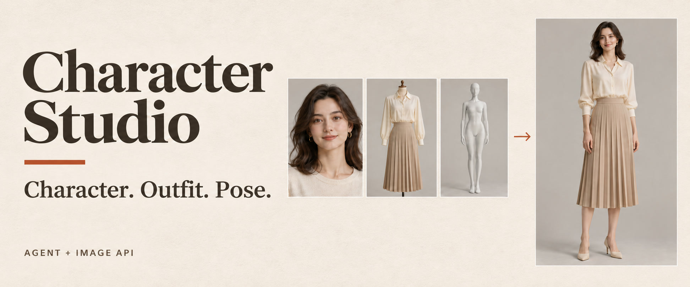
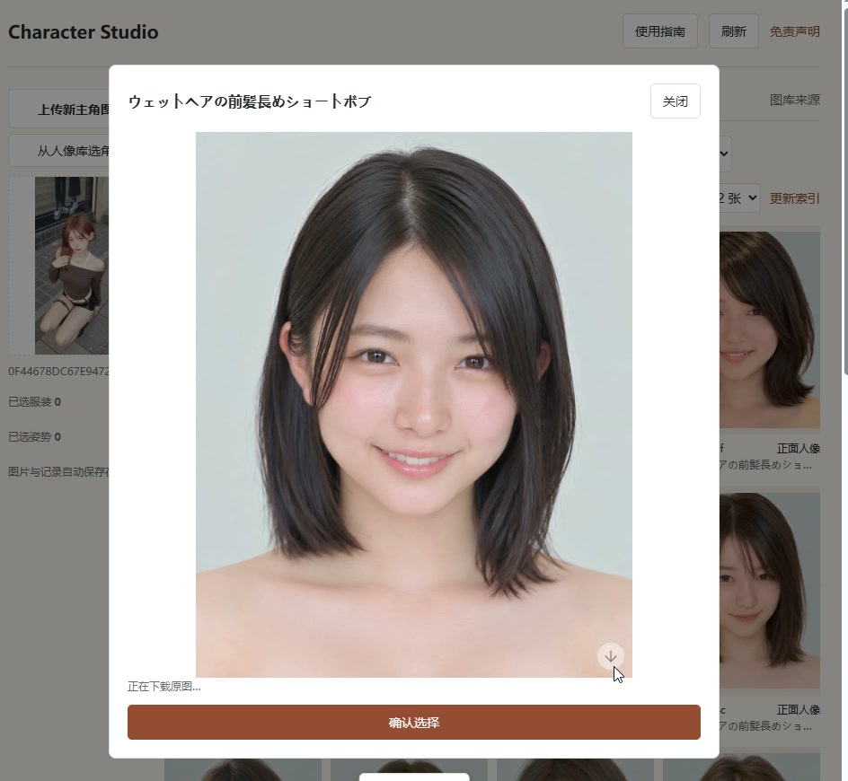
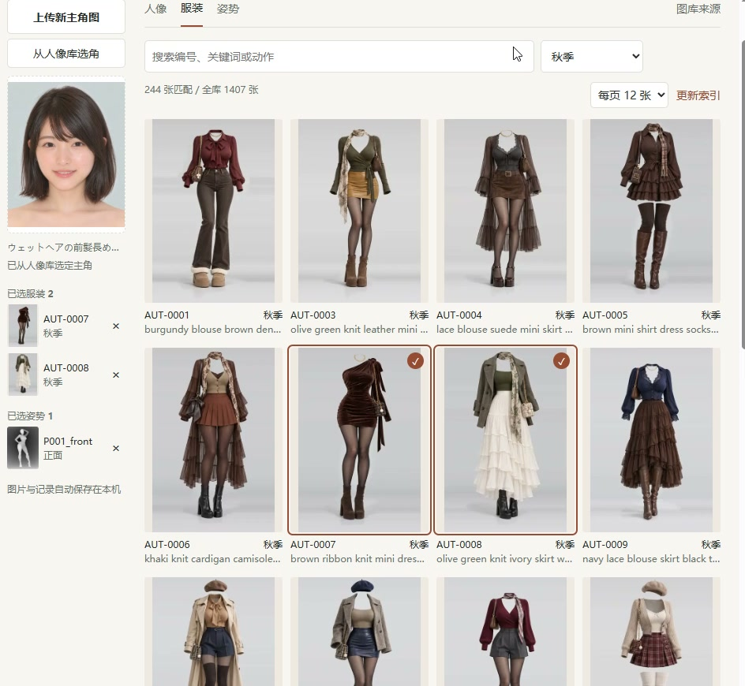
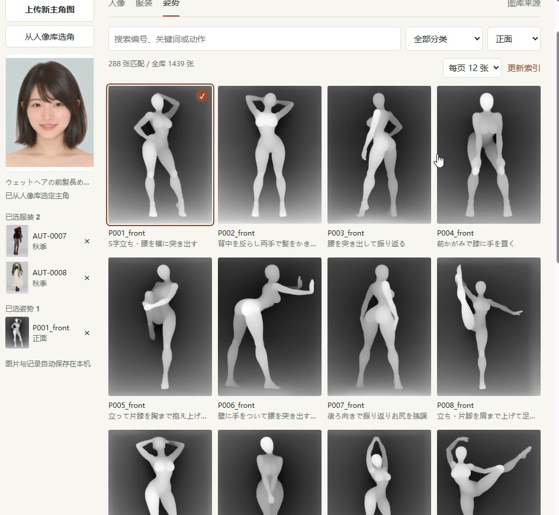
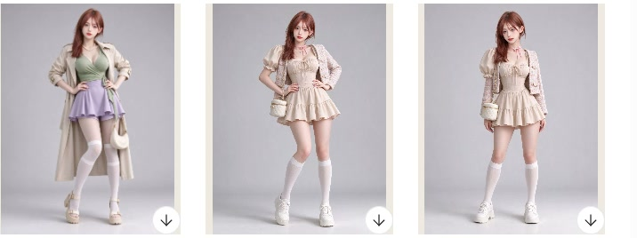
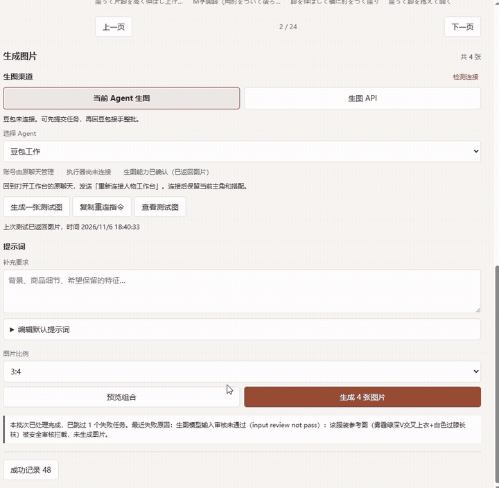

<p align="center">
  
</p>

<p align="center"><strong>A visual workbench for character images</strong><br>Choose one character, mix outfits and poses, then generate a batch with your agent or image API.</p>

<p align="center">
  <a href="README.md">简体中文</a> · <a href="README.en.md">English</a> · <a href="docs/demos.md#english">Demos</a> · <a href="docs/troubleshooting.md">Troubleshooting</a>
</p>

<p align="center">
  <a href="https://github.com/web3suihuiji-ctrl/character-studio/releases/latest"></a>
  <a href="https://github.com/web3suihuiji-ctrl/character-studio/actions/workflows/windows.yml"></a>
  <a href="LICENSE"></a>
</p>

<p align="center">
  <a href="https://github.com/web3suihuiji-ctrl/character-studio/releases/latest/download/Character-Studio-Windows-x64.exe"></a>
  &nbsp; <a href="https://github.com/web3suihuiji-ctrl/character-studio/releases/latest/download/character-studio-windows-x64.zip">Download ZIP</a>
  &nbsp; · &nbsp; <a href="#open-through-an-agent">Open through an agent</a>
</p>

<p align="center"><sub>Windows x64 · ~39 MB · Runtime included · Images and history stay on your computer</sub></p>

## From references to results

Pick a character from the portrait gallery or upload your own image. Select multiple outfits and poses, or use only one type of reference.

<table>
  <tr><th width="33%">1. Choose a character</th><th width="33%">2. Style the outfit</th><th width="33%">3. Choose a pose</th></tr>
  <tr>
    <td></td>
    <td></td>
    <td></td>
  </tr>
  <tr><td>Use a gallery portrait or upload one character.</td><td>Preview before selecting. Choose several looks at once.</td><td>Pick an action and view, then preview the combinations.</td></tr>
</table>

### Actual generated results



The successful results dialog groups images by batch. Name a batch, download all its images as a ZIP, or save an individual original image.

<details>
<summary><strong>Watch the recording: review results and download images</strong></summary>



</details>

[Watch the reference-selection and generation demos →](docs/demos.md#english)

<sub>Screenshots and GIFs come from the author's Doubao Work desktop recordings. The cover is an AI-generated brand illustration.</sub>

## Download, then double-click

| Download | Open |
|---|---|
| **[Windows EXE (recommended)](https://github.com/web3suihuiji-ctrl/character-studio/releases/latest/download/Character-Studio-Windows-x64.exe)** | Double-click. The first launch prepares the application and opens the workbench. |
| [Windows ZIP](https://github.com/web3suihuiji-ctrl/character-studio/releases/latest/download/character-studio-windows-x64.zip) | Extract everything and run **Character Studio.exe**, keeping the adjacent folders together. |

Node.js installation and administrator access are not required. The [Windows release](https://github.com/web3suihuiji-ctrl/character-studio/releases/latest) includes SHA-256 checksums. Executables are currently unsigned. Full external galleries are loaded as needed rather than bundled in the download.

### Open through an agent

Send this to a Windows agent that can run programs on your computer:

```text
Install and open https://github.com/web3suihuiji-ctrl/character-studio . Follow INSTALL.en.md, connect your existing image-generation tools, and wait for me to submit a task in the workbench.
```

The agent downloads the prebuilt application and starts it. Doubao Work on desktop uses its built-in browser first; other compatible hosts can embed the workbench in chat. When embedding is unavailable, the agent opens the system browser.

**Connecting Doubao:** select Current Agent → Doubao Work, copy the reconnect instruction, and send it in the original Doubao chat. If a submitted batch is waiting for handoff, copy the handoff instruction and send it in that chat. Your character and selected references are preserved.

Agents performing installation should follow [INSTALL.en.md](INSTALL.en.md) and use the bundled program entry point instead of operating MCP settings through Computer Use.

## Choose how to generate

| Channel | Setup |
|---|---|
| **Current agent** | Choose Codex or Doubao Work and connect its existing image tools. Login, executor connection and image-generation capability are shown separately. |
| **Image API** | Presets for OpenAI, Google Gemini and Volcengine Seedream, plus custom compatible endpoints. Enter your key in the Manage API Key dialog; the Key guide links to the official provider pages. |

Choose an aspect ratio and submit the entire batch. Preview combinations, edit the default prompt, add requirements, pause, cancel or retry an individual image. APIs are billed under the provider's rules. Native generation depends on the agent's account and actual tools. The workbench UI is in Simplified Chinese.

## Compatibility

| Component | Status |
|---|---|
| Windows x64 | Bundled runtime; local installation, repair, startup, and reuse tested |
| Codex | Local executor and MCP Apps entry point; generation depends on the account and available tools |
| Doubao Work | Entry point without MCP registration; the recordings show reference selection, submission and result review. Connection and file return depend on the current client capabilities |
| Image APIs | Three built-in services and model presets, plus custom OpenAI image-edit, Gemini, and Seedream endpoints. Protocols and UI are tested against isolated fixtures; live access and quotas depend on the provider account. |
| macOS / Linux | No end-user distribution yet |

Choose one character, then an outfit, a pose, or both. Generated images return to the local successful results history. See [providers](docs/providers.md) and [troubleshooting](docs/troubleshooting.md).

## Local data and external libraries

Character references, cached assets, tasks, results, and settings live in `~/.character-studio`. Upgrading the application does not replace this directory. Do not send API keys in chat; enter them in the local settings. Generation failures are reported rather than replaced with placeholder images.

References come from the [portrait gallery](https://ai-portrait-gallery.pages.dev/), [depth pose gallery](https://ai-pose-depth-gallery.pages.dev/), and [costume gallery](https://ai-costume-gallery.pages.dev/). Thumbnails load while browsing, and full references download when needed.

The code is licensed under [MIT](LICENSE). External images and metadata are not covered by the project's MIT license; see [NOTICE](NOTICE.md).

## Development

Node.js 22.12+ is required for source development. End users use the bundled runtime instead.

```powershell
npm ci
npm run build
npm test
python -m pip install playwright==1.61.0
python -m playwright install chromium
python -X utf8 tests/browser.py
python -X utf8 tests/browser_auto.py
python -X utf8 tests/browser_personal.py
python -X utf8 tests/browser_cli.py
python -X utf8 tests/browser_reference_download.py
npm run package:windows
python -X utf8 tests/launcher_smoke.py
```

Windows packaging produces an EXE, a ZIP and their SHA-256 sidecars under `.local/distribution/`. Upload all four to the same GitHub Release. The final check exercises both actual release launchers.

[Contributing](CONTRIBUTING.md) · [Architecture](docs/architecture.md) · [Changelog](CHANGELOG.md) · [Releasing](docs/releasing.md) · [Report an issue](https://github.com/web3suihuiji-ctrl/character-studio/issues/new/choose) · [Security](SECURITY.md)
