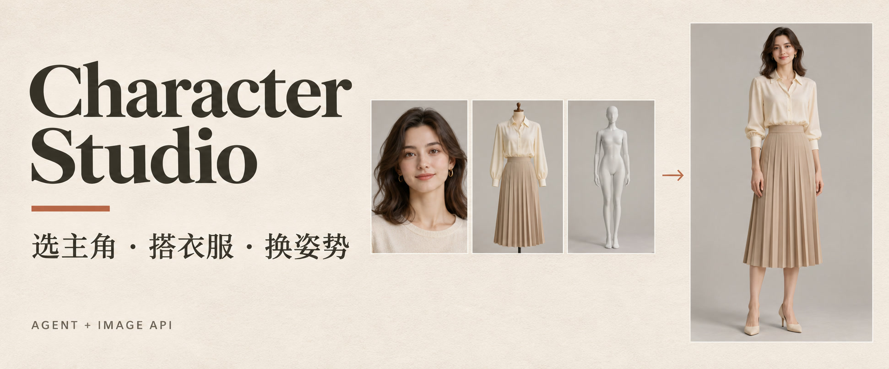
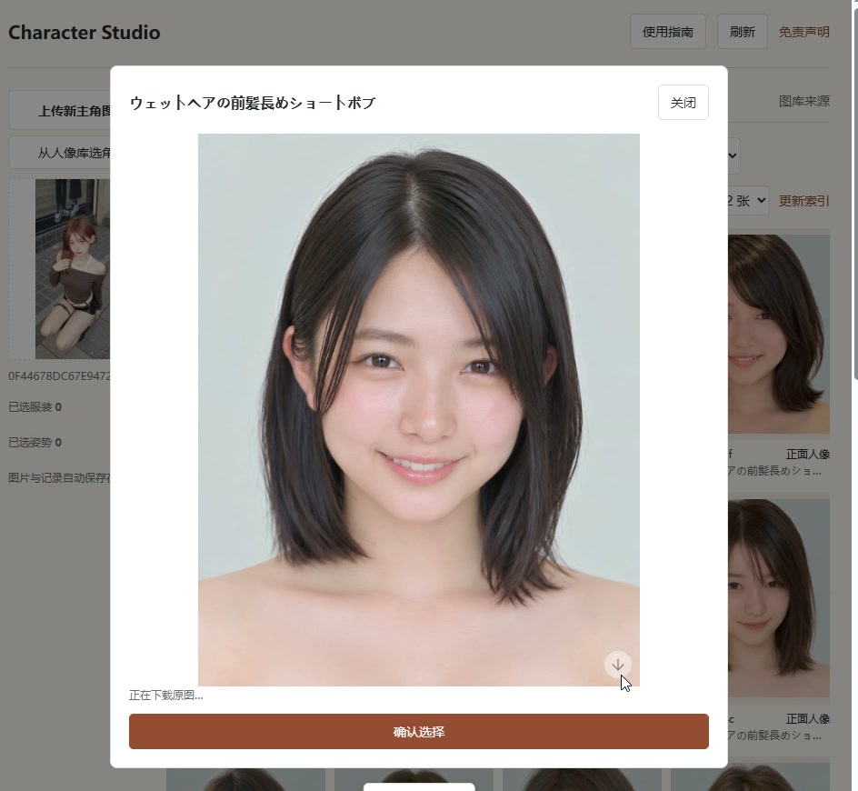
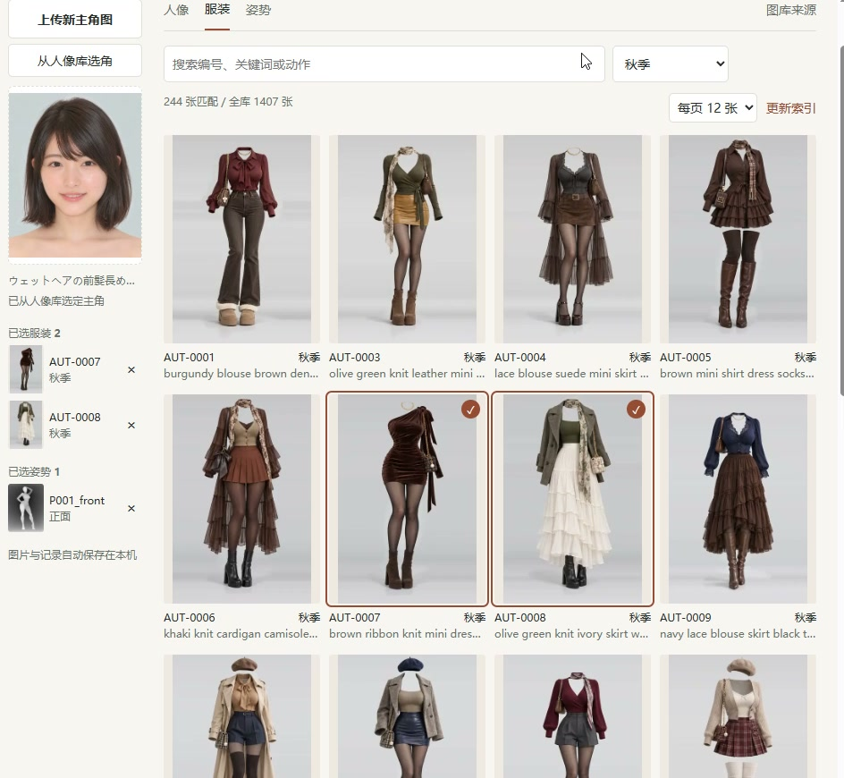
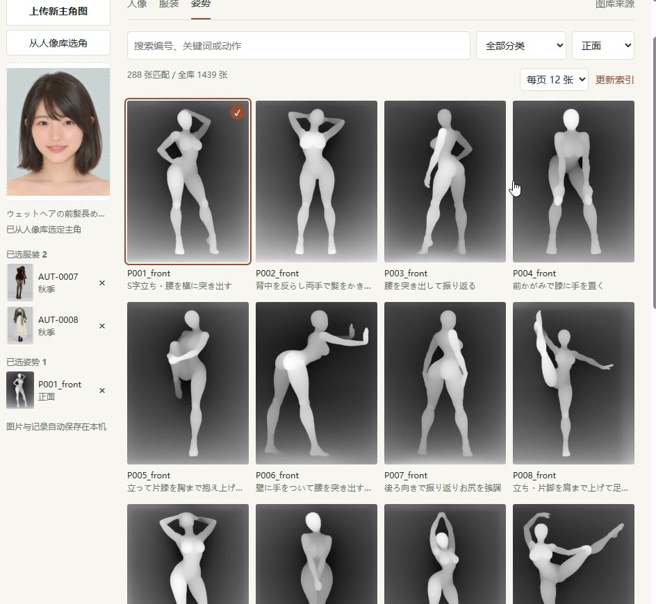
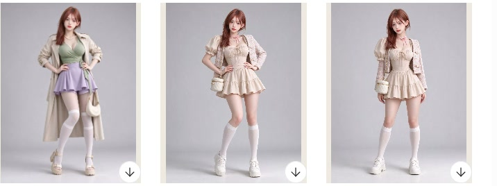
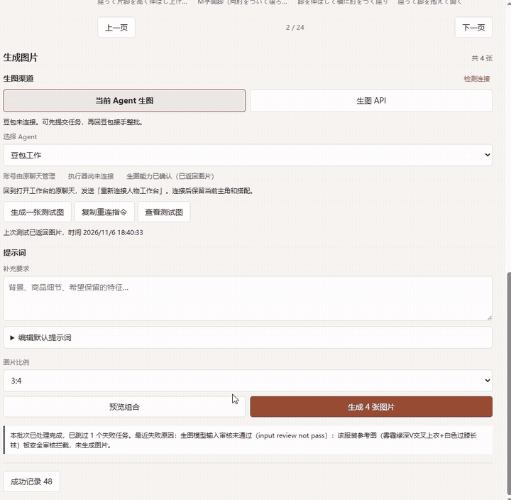

<p align="center">
  
</p>

<p align="center"><strong>人物换装与姿势生图工作台</strong><br>选一位主角，搭配多套衣服和姿势，交给 Agent 或生图 API 批量生成。</p>

<p align="center">
  <a href="README.md">简体中文</a> · <a href="README.en.md">English</a> · <a href="docs/demos.md">操作演示</a> · <a href="docs/troubleshooting.md">常见问题</a>
</p>

<p align="center">
  <a href="https://github.com/web3suihuiji-ctrl/character-studio/releases/latest"></a>
  <a href="https://github.com/web3suihuiji-ctrl/character-studio/actions/workflows/windows.yml"></a>
  <a href="LICENSE"></a>
</p>

<p align="center">
  <a href="https://github.com/web3suihuiji-ctrl/character-studio/releases/latest/download/Character-Studio-Windows-x64.exe"></a>
  &nbsp; <a href="https://github.com/web3suihuiji-ctrl/character-studio/releases/latest/download/character-studio-windows-x64.zip">下载 ZIP</a>
  &nbsp; · &nbsp; <a href="#在-agent-里打开">在 Agent 里打开</a>
</p>

<p align="center"><sub>Windows x64 · 约 39 MB · 自带运行环境 · 图片与记录保存在本机</sub></p>

## 从选角到出图

从人像库选角，也可以上传自己的主角图。服装和姿势支持多选，还可以只换衣服、只换姿势。

<table>
  <tr><th width="33%">1. 选主角</th><th width="33%">2. 搭衣服</th><th width="33%">3. 换姿势</th></tr>
  <tr>
    <td></td>
    <td></td>
    <td></td>
  </tr>
  <tr><td>人像库选角或自己上传，只保留一位主角。</td><td>点开大图确认，喜欢的搭配可以一起选。</td><td>选择动作与视角，预览组合后开始生成。</td></tr>
</table>

### 实际生成效果



图片完成后，点「成功记录」查看。支持按批次命名、整批打包下载，以及单张原图下载。

<details>
<summary><strong>点开看实录：查看结果与下载原图</strong></summary>



</details>

[查看选角、搭配与生图的操作演示 →](docs/demos.md)

<sub>操作截图和动图取自作者提供的豆包工作桌面端录屏；顶部封面由 AI 制作，为品牌示意图。</sub>

## 下载后，双击打开

| 下载方式 | 怎么打开 |
|---|---|
| **[Windows EXE（推荐）](https://github.com/web3suihuiji-ctrl/character-studio/releases/latest/download/Character-Studio-Windows-x64.exe)** | 下载后双击，首次自动准备程序，然后打开工作台。 |
| [Windows ZIP](https://github.com/web3suihuiji-ctrl/character-studio/releases/latest/download/character-studio-windows-x64.zip) | 完整解压，双击 **Character Studio.exe**，保留同目录的文件夹。 |

不用另装 Node.js，无需管理员权限。完整文件和 SHA-256 校验见 [Windows 发行版](https://github.com/web3suihuiji-ctrl/character-studio/releases/latest)。EXE 当前未进行代码签名。安装包不包含整套图库，浏览和选用时自动加载所需素材。

### 在 Agent 里打开

把下面这段发给能运行本机程序的豆包工作、Codex 等 Agent：

```text
安装并打开 github上的web3suihuiji-ctrl/character-studio ，按 INSTALL.md 执行，连接你当前已有的生图能力，等待我在工作台提交。
```

Agent 下载打包好的程序并启动工作台。豆包工作桌面端优先使用内置浏览器，其他宿主在支持时内嵌到聊天；内嵌入口不可用时打开系统浏览器。

**豆包连接提示：**右侧选择「当前 Agent 生图 → 豆包工作」，点击「复制重连指令」，回到打开工作台的豆包原聊天发送。提交后若显示等待接手，点击「复制接手指令」，回原聊天发送，即可让豆包处理本批待生成图片。主角和搭配会保留。

给执行安装的 Agent：[安装步骤](INSTALL.md)。直接使用随包程序入口，无需通过 Computer Use 反复操作 MCP 设置页面。

## 选择你要用的生图方式

| 渠道 | 使用方式 |
|---|---|
| **当前 Agent** | 选择 Codex 或豆包工作，连接已有的生图能力。工作台分别显示登录、执行器连接和生图能力状态。 |
| **生图 API** | 预设 OpenAI、Google Gemini、火山方舟 Seedream，也支持自定义兼容接口。在「管理 API Key」弹窗填写 Key，「获取 Key 教程」提供对应官方入口。 |

选好渠道与图片比例后，点击生成整批图片；支持先预览组合、编辑默认提示词、填写补充要求、暂停后续任务、取消批次和单张重做。API 调用按所选服务的规则计费；Agent 生图取决于当前账号和实际工具能力。

## 当前支持范围

| 项目 | 当前状态 |
|---|---|
| Windows x64 | 自带运行环境；本机安装、修复、启动与重复打开已测试 |
| Codex | 提供本机执行器和原生 MCP Apps 入口，实际生图取决于账号与当前工具 |
| 豆包工作 | 提供免配 MCP 接入；本页实录展示选材、任务提交与结果查看。连接及文件回填仍取决于当前客户端能力 |
| 生图 API | 预设三家服务与模型；自定义接口支持 OpenAI 图片编辑、Gemini 和 Seedream 协议。协议与界面已用隔离测试接口验证，实际权限和额度由服务商账号决定 |
| macOS／Linux | 尚未提供面向普通用户的发行包 |

上传或选定一位主角后，可以只选服装、只选姿势，或同时选择两者。结果自动保存到本机成功记录。更多说明见[生图渠道](docs/providers.md)和[常见问题](docs/troubleshooting.md)。

## 数据与素材

主角、原图缓存、任务、生成结果和个人设置保存在本机 `~/.character-studio`。升级安装程序不会覆盖这些内容。Key 不需要发到聊天里，失败不会用占位图冒充生成结果。

素材来自 [人像图库](https://ai-portrait-gallery.pages.dev/)、[深度姿势图库](https://ai-pose-depth-gallery.pages.dev/)和[服装图库](https://ai-costume-gallery.pages.dev/)。浏览时加载缩略图，选用时自动下载需要的原图。

软件代码使用 [MIT](LICENSE) 许可；第三方图片与元数据不属于本项目的 MIT 授权，参见 [NOTICE](NOTICE.md)。

## 开发与验证

需要 Node.js 22.12+。开发者执行：

```powershell
npm ci
npm run build
npm test
python -X utf8 tests/browser.py
python -X utf8 tests/browser_auto.py
python -X utf8 tests/browser_personal.py
python -X utf8 tests/browser_cli.py
python -X utf8 tests/browser_reference_download.py
npm run package:windows
python -X utf8 tests/launcher_smoke.py
```

打包命令生成自带运行环境的 Windows EXE、ZIP 及各自的 `.sha256` 校验文件，位于 `.local/distribution/`。最后一个命令检查这两个实际发行包的启动。发布者将四个文件上传到 GitHub Release，用户无需执行这些开发命令。

原生 Codex 插件的开发安装脚本为 `scripts/install-codex-dev.ps1`。欢迎提交问题与改进：

- [贡献指南](CONTRIBUTING.md) · [架构说明](docs/architecture.md)
- [版本记录](CHANGELOG.md) · [发布流程](docs/releasing.md)
- [问题反馈](https://github.com/web3suihuiji-ctrl/character-studio/issues/new/choose) · [安全问题](SECURITY.md)
