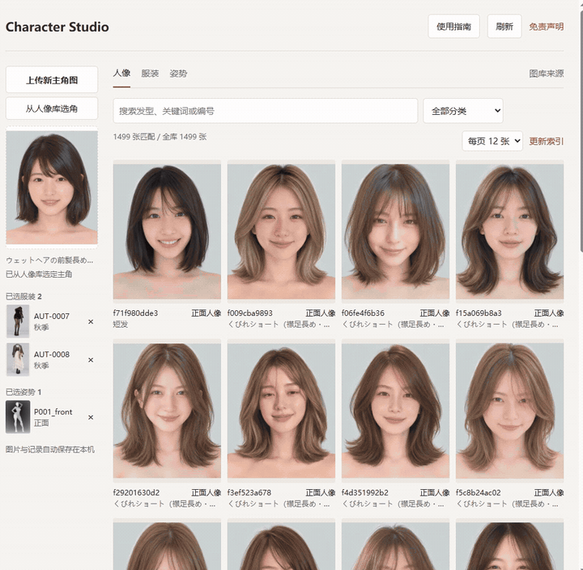
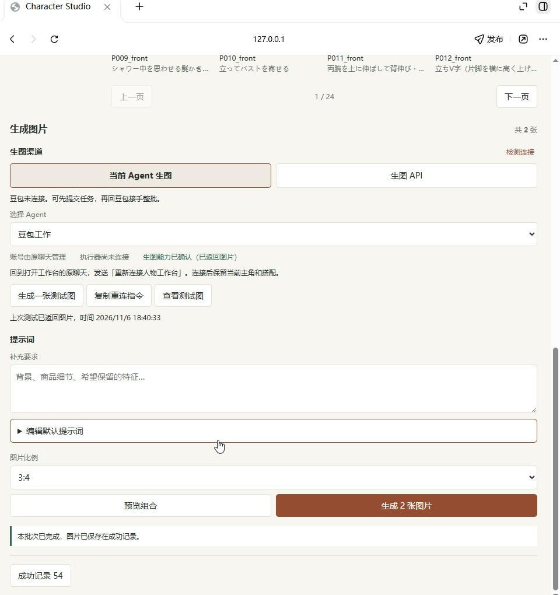
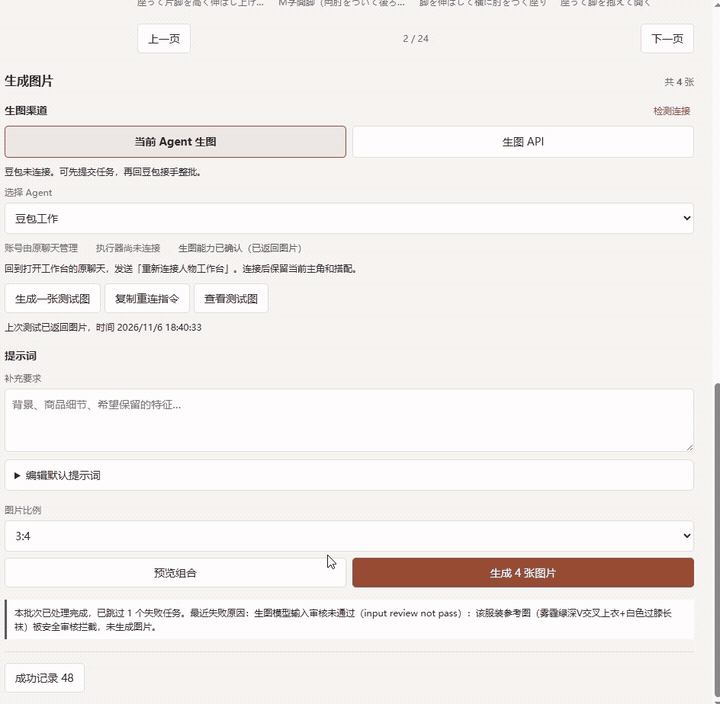

# 操作演示 / Demos

[返回项目主页](../README.md) · [English](#english)

以下素材来自作者提供的豆包工作桌面端录屏。动图已裁掉聊天区域、去除声音并加速，保留实际工作台画面。

## 选主角、挑衣服和姿势

1. 从人像库选择一位主角，或上传自己的图片。
2. 点开服装和姿势的大图，确认后加入搭配，可以多选。
3. 选择渠道与比例，预览组合后点击生成。

## 提交生成任务

右侧选择「当前 Agent 生图」或「生图 API」。豆包模式下，按工作台的连接与接手提示回原聊天发送指令；API 模式下，在「管理 API Key」弹窗填写对应服务的 Key。

下面是录屏中的整批完成状态。等待生成的时间已从主页展示中省略，实际耗时取决于渠道、模型和队列。

## 查看结果、下载原图

点「成功记录」，按批次查看图片。点图片看大图，右下角箭头下载单张原图；「下载本批全部图片」打包为 ZIP。

## English

These demonstrations were extracted from the author's Doubao Work desktop recordings. Chat areas are cropped out; playback is accelerated and silent. The images show actual application use.

- **Choose references:** pick one portrait or upload your own, then preview and select outfits and poses. Multiple selections create a batch of combinations.
- **Generate:** choose an agent or image API and an aspect ratio, then submit. In Doubao mode, send the connection or handoff instruction in the original chat when prompted. API keys are entered in a local dialog.
- **Review and download:** open successful results, browse by batch, preview a large image, download one original, or download a batch ZIP.

The GIFs above run at 2.5× and 1.6× respectively. The completion screenshot comes from a separate longer recording; generation wait time is omitted from the homepage presentation. Actual latency depends on the provider, model and queue. Recordings show the Chinese workbench UI.

[Back to the project](../README.en.md) · [Media sources](assets/README.md)
